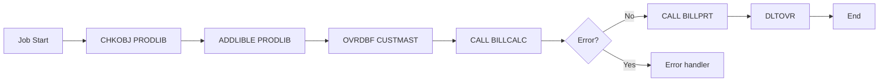

# AS/400 CL Program Decomposition

CL (Control Language) is the IBM i equivalent of JCL on mainframe — but it's significantly more powerful. CL programs orchestrate RPG programs, manage files, override database access, schedule submitted jobs, and control program flow with `IF/ELSE/GOTO/DOWHILE`. They're often where the real business logic lives, not in the RPG they call.

Migrating CL to modern orchestration (Spring Batch, Step Functions, Airflow) requires decomposition — not literal translation. CL has features that don't exist in modern frameworks (override database files, library list manipulation, message handling) and modern frameworks have features CL lacks (parallel execution, dynamic scaling, observability).

## When to use

- Migrating CL programs that orchestrate RPG batch processing
- The target is a modern batch framework or event-driven architecture
- You need to preserve sequencing, dependencies, and error handling — not just port commands

## Why CL is different from JCL

If you're coming from a COBOL/mainframe background, expect CL to be:

| Aspect | JCL | CL |
|--------|-----|-----|
| Power | Static job control | Programmable (variables, conditionals, loops) |
| Reusability | Limited (PROCs) | Subprograms, parameters, called from anywhere |
| File overrides | DD statements | OVRDBF (more flexible) |
| Database access | Indirect (via app) | Direct (RUNSQL, RUNQRY) |
| Conditional execution | COND= return codes | IF/ELSE with full expressions |
| Loops | Not really | DOWHILE / DOFOR / DOUNTIL |
| Error handling | COND on next step | MONMSG with exception handling |
| Variables | Symbolic params only | Full programmable variables |

CL is much more like a programming language than JCL. This means:
- Migration is more complex (more logic to capture)
- The CL itself often holds business rules (extract them too)
- Modern equivalents need to handle more than just job sequencing

## Prompt

````text
You are a senior IBM i architect with experience modernizing AS/400 batch
processing. Decompose the CL program below into a target architecture that
preserves the business outcomes without literal translation.

## Input

**CL source:**
```cl
{{cl_source}}
```

**Job scheduler:** {{job_scheduler}}
**Target runtime:** {{target_runtime}}
**Timing constraints:** {{timing_constraints}}

## Output

A Markdown document organized as follows:

### 1. Program overview

- **Program name** (from PGM card)
- **Business purpose** (in plain language)
- **Frequency** (daily / weekly / monthly / on-demand / continuous)
- **Run window** (when it must start and finish)
- **Critical path?** (does anything else wait for this?)
- **Failure impact** (what happens if it doesn't run? doesn't finish?)

### 2. Parameters

If the CL takes parameters (DCL VAR statements with PARM):

| Parameter | Type | Length | Purpose | Default | Source |
|-----------|------|--------|---------|---------|--------|
| &RUNDATE | *CHAR | 8 | Run date in CCYYMMDD | sysdate | Job scheduler |
| &MODE | *CHAR | 1 | Run mode: P=production, T=test | P | Caller |
| &CUSTNO | *CHAR | 7 | Customer to process (blank = all) | blank | Manual |

### 3. Variable declarations

For each `DCL VAR()` statement, document:

| Variable | Type | Length | Purpose | Set where |
|----------|------|--------|---------|-----------|
| &CUSTCNT | *DEC | 9 0 | Count of customers processed | Updated in loop |
| &MSGID | *CHAR | 7 | Last message ID (for error handling) | RCVMSG |

### 4. Operations breakdown

For each significant CL operation, document:

#### File / library operations

```cl
ADDLIBLE LIB(PRODLIB) POSITION(*FIRST)
OVRDBF FILE(CUSTMAST) TOFILE(WRKLIB/CUSTMAST) SHARE(*YES)
```

| Operation | Effect | Modern equivalent concern |
|-----------|--------|---------------------------|
| ADDLIBLE | Adds library to job's library list | Connection routing / schema selection |
| OVRDBF | Override file at job level | Connection string parameter |
| RTVMBRD | Get file member info | Schema introspection (rare in modern) |
| RGZPFM | Reorganize physical file | Modern DBs handle automatically |
| CHKOBJ | Check if object exists | File existence check / SQL exists |
| ALCOBJ | Allocate exclusive use | Distributed locks (Redis, DB locks) |

For each, document what it accomplishes and the target equivalent.

#### Submitted jobs

```cl
SBMJOB CMD(CALL PGM(BILLCALC) PARM(&RUNDATE)) JOB(BILLCALC) JOBQ(QBATCH)
```

| Submission | Job queue | Purpose | Target equivalent |
|------------|-----------|---------|-------------------|
| SBMJOB CALL BILLCALC | QBATCH | Run billing calc async | Spring Batch job, async invocation |
| SBMJOB CMD(...) JOBQ(QPRINT) | QPRINT | Print large report | Async print queue / PDF generation |

For each SBMJOB, document:
- What's being submitted (CL or RPG program)
- Job queue (different queues = different priority/throughput)
- Whether parent waits for completion
- Modern equivalent

#### CALL statements

```cl
CALL PGM(BILLCALC) PARM(&RUNDATE &MODE)
```

For each CALL:
- Program called
- Parameters passed
- Whether to migrate together or independently

#### Database operations

```cl
RUNSQL SQL('UPDATE CUSTMAST SET STATUS = ''A'' WHERE STATUS = '' ''') 
       COMMIT(*NONE)
RUNQRY QRYFILE((CUSTRPT))
```

| Operation | Purpose | Modern equivalent |
|-----------|---------|-------------------|
| RUNSQL | Direct SQL execution | JdbcTemplate / Dapper / EF Core |
| RUNQRY | Run pre-built query | Stored query or pre-built report |
| OPNQRYF | Open dynamic query | SQL or ORM with predicate |
| CPYF | Copy from file to file | INSERT FROM SELECT |
| CRTDUPOBJ | Create duplicate file | TABLE AS SELECT |

#### Message handling

```cl
RCVMSG MSGTYPE(*LAST) MSGID(&MSGID) MSGDTA(&MSGDTA)
SNDPGMMSG MSG('Process complete') TOPGMQ(*EXT)
MONMSG MSGID(CPF0000) EXEC(GOTO ERROR)
```

This is unique to IBM i and important to preserve. Document:
- **MONMSG patterns** — what error conditions are handled, how
- **SNDPGMMSG / SNDMSG** — where messages go (joblog, user message queue, external message queue)
- **Error escalation** — how errors propagate up

Modern equivalents:
- MONMSG → try/catch with specific exception types
- SNDPGMMSG → structured logging (SLF4J / ILogger)
- Joblog inspection → centralized logs

#### Conditional logic

CL has full IF/ELSE expressions:

```cl
IF (&CUSTCNT *EQ 0) THEN(DO)
    SNDPGMMSG MSG('No customers processed') TOPGMQ(*EXT)
    GOTO END
ENDDO
ELSE DO
    CALL PGM(BILLPRT) PARM(&CUSTCNT)
ENDDO
```

Translate to target equivalent (Spring Batch decision branches, Step Functions Choice states, etc.).

#### Loops

```cl
DOWHILE COND(&MORE *EQ '1')
    CALL PGM(NEXTCUST) PARM(&CUSTNO &MORE)
ENDDO
```

DOWHILE / DOFOR / DOUNTIL → modern loop constructs. For batch, often
restructured as item-based processing rather than custom loops.

### 5. Data flow

Visualize the data flow with Mermaid:



### 6. Implicit dependencies

Beyond what's in CL, identify:

- **Library list dependencies:** which libraries must be in the job's library list
- **Authority dependencies:** which user profile / authorities required
- **Object dependencies:** which programs/files must exist
- **Cross-job dependencies:** what other CL programs schedule this one
- **External job consumers:** what runs after this completes

CL often relies on implicit job environment that's hard to see in source.

### 7. Restart and recovery analysis

For each significant section, document:

- **Idempotent?** Can the section run twice without harm?
- **Checkpoint frequency?** Does the program commit / save progress?
- **Restart capability?** Can the job restart from a specific point?
- **Output cleanup needed?** Are output files in partial state on failure?

CL's MONMSG-driven error handling is different from modern try/catch — document the actual recovery semantics, not just the syntax.

### 8. Target architecture decomposition

For target_runtime = "Spring Batch":

```markdown
## CL: BILLNIGHT → Spring Batch Job: NightlyBillingJob

**Job structure:**
- Step 1: SetupStep — equivalent of OVRDBF (connection routing)
- Step 2: BillingCalculationStep — calls BILLCALC equivalent service
- Step 3: BillingPrintStep — generates PDF/email instead of printer
- Step 4: CleanupStep — equivalent of DLTOVR

**Conditional flow (replacing IF logic):**
- After Step 2, decide: count > 0 → Step 3, else → terminate
- Use Spring Batch decisions or flow with conditions

**Error handling (replacing MONMSG):**
- @StepScope with retry policy
- Failed step → error notification email
- Job-level listener for cleanup
```

For target_runtime = "Step Functions":

```markdown
## CL: BILLNIGHT → Step Functions State Machine

**State machine:**
- Pass state for parameter setup
- Task state: Lambda for billing calc
- Choice state: branch on count > 0
- Task state: Lambda for print/email
- Catch handlers replace MONMSG

**Why Standard not Express:**
- Long-running (multiple hours)
- Need exactly-once semantics
- Need full execution history for audit
```

For target_runtime = "Airflow":

```markdown
## CL: BILLNIGHT → Airflow DAG

**DAG tasks:**
- setup (PythonOperator)
- billing_calculation (KubernetesPodOperator running container)
- decision (BranchPythonOperator on count > 0)
- billing_print (PythonOperator)
- cleanup (always runs)

**Scheduling:**
- daily @ 22:00 UTC
- depends_on_past=False
- max_active_runs=1
```

Match recommendations to actual target_runtime.

### 9. CL business rules to extract

CL programs often contain real business rules, not just orchestration:

```cl
IF (&AMOUNT *GT 100000) THEN(DO)
    SNDPGMMSG MSG('Amount exceeds threshold; manager approval required')
    GOTO MGRAPP
ENDDO
```

This is a business rule (`amount > 100000 requires manager approval`), not job control. Extract these rules separately — they belong in the business rule catalog, not in the orchestration migration.

### 10. Sequencing strategy in target

Map CL coordination to target framework:

| CL way | Spring Batch | Step Functions | Airflow |
|--------|--------------|----------------|---------|
| Sequential CALLs | Step → Step | Sequential states | task_a >> task_b |
| IF/ELSE branches | Decider / FlowBuilder | Choice state | BranchPythonOperator |
| DOWHILE loop | Tasklet with custom logic | Map state with iteration | for-loop or task group |
| MONMSG handlers | RetryPolicy / SkipPolicy | Catch / Retry | retry / on_failure_callback |
| SBMJOB async | Async step / Partitioning | Parallel state | TaskGroup with multiple |
| GOTO label | Job flow definition | Choice state | DAG dependencies |

### 11. Throughput and SLA analysis

- **Current throughput** (records/sec or runtime in current environment)
- **Required throughput** (to fit batch window)
- **Target throughput** (with parallelization, partitioning, modern infra)
- **Bottleneck analysis** (CPU? I/O? batch queue contention?)

IBM i is generally efficient at I/O-heavy batch. Modern targets may need
explicit parallelization to match. Don't assume "modern = faster" without
testing.

### 12. Operational concerns

- **Monitoring:** what do operators watch today (job log, WRKACTJOB)? Modern equivalent (CloudWatch, Grafana)?
- **Alerting:** when does a human get paged? Map to modern alerting.
- **Run history:** how long is history kept on IBM i? Modern equivalent often shorter retention.
- **Re-run procedures:** how do operators re-run a failed job today? Document modern equivalent.
- **Production support:** does the legacy require special skills (RPG/CL operators)? Plan for skills transition.

### 13. Migration risks specific to CL

- **Library list assumptions:** CL relies on job library list; modern doesn't have an equivalent
- **OVRDBF behavior:** file overrides change file binding at runtime; modern needs explicit alternatives
- **Message-driven flow:** RCVMSG / MONMSG patterns don't translate cleanly
- **Job queue priorities:** different queues = different priorities; modern needs explicit priority
- **Output queue / spooled files:** print output goes to OUTQs; modern needs PDF/email path
- **Data area / data queue:** common IBM i communication mechanisms; need replacement (Redis, message queue)

## Quality bar

- Every CL operation has a target equivalent
- Implicit dependencies (library list, authorities, object existence) documented
- MONMSG / error handling explicit
- Business rules separated from orchestration
- Throughput analysis realistic
- Open questions listed honestly

## Style

- Specific to actual CL provided
- Match recommendations to actual target_runtime
- Honest about what CL does that modern frameworks don't (and vice versa)
````

## Tips

- **Run on the most critical CL programs first.** Job streams aren't independent; understanding one helps with the next.
- **Pair with the Business Rule Extraction template.** CL often holds business rules in IF statements; extract those too.
- **Talk to operators.** They know which CLs really run in production vs which are old/abandoned.
- **Don't skip the implicit dependencies.** Library lists and OVRDBF behavior cause subtle bugs in migrations.
- **Consider event-driven over batch where it fits.** Some "batch" CL programs are really queues that piled up overnight; could be event-driven on the new platform.

## Common mistakes to avoid

- **Literal CL → modern step translation.** Modern frameworks have different semantics; preserving CL structure produces awkward results.
- **Ignoring MONMSG handlers.** They often handle expected error paths that modern frameworks need to replicate explicitly.
- **Missing the library list dependency.** "Why doesn't this work?" because the job's library list isn't replicated in the modern target.
- **Treating CALL the same as SBMJOB.** Sync vs async distinction matters.
- **Underestimating data volumes.** Same trap as JCL — test environments deceive.
- **Skipping the OUTQ / spooled file question.** Print output often gets forgotten; users notice when their reports stop arriving.
- **Putting business rules in the orchestration migration.** Extract them to the rule catalog instead.
