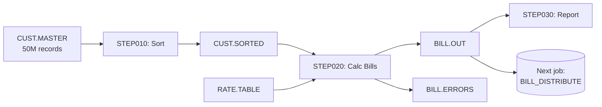

# COBOL Batch Job Decomposition

Mainframe batch is its own world. JCL coordinates programs that read files in specific orders, with checkpoints, restart logic, and dependencies that have evolved over decades. Migrating these to modern batch (Spring Batch, .NET Worker, Airflow, Step Functions) requires careful decomposition — not literal translation.

## When to use

- Migrating COBOL batch programs (not online CICS — that's different)
- The legacy uses JCL to coordinate multi-step jobs
- The target is a modern batch framework or event-driven architecture
- You need to preserve sequencing and dependencies, not just port programs

## Why this is hard

Common pitfalls when migrating mainframe batch:

- **Treating each program as standalone.** They're not. Job streams have implicit data flow (file produced by step 1 read by step 3) that's easy to miss.
- **Ignoring restart logic.** Mainframe jobs often restart from a specific step on failure. Modern frameworks handle this differently.
- **Missing scheduler dependencies.** CA-7 / Control-M / OPC have cross-job dependencies that aren't visible in JCL alone.
- **Underestimating volume.** Batch jobs often run on data volumes (10s of millions of records) that overwhelm naive modern implementations.
- **Losing batch windows.** Mainframe batch is optimized for throughput in tight windows. "Run faster individually" isn't the same as "fit the window."

## Prompt

````text
You are a senior batch architect with deep mainframe and modern batch
experience. Decompose the JCL job stream below into a target architecture
that preserves the business outcomes without literally translating JCL.

## Input

**JCL source:**
```jcl
{{jcl_source}}
```

**Scheduler:** {{scheduler}}
**Target runtime:** {{target_runtime}}
**Timing constraints:** {{timing_constraints}}

## Output

A Markdown document organized as follows:

### 1. Job stream overview

- **Job name** (from JOB statement)
- **Business purpose** (in plain language)
- **Frequency** (daily / weekly / monthly / on-demand)
- **Run window** (when it must start and finish)
- **Critical path?** (does anything else wait for this?)
- **Failure impact** (what happens if it doesn't run? doesn't finish?)

### 2. Step inventory

For each STEP in the JCL, document:

| Step name | Program | Purpose | Inputs (DDNAMEs) | Outputs (DDNAMEs) | Notes |
|-----------|---------|---------|-------------------|---------------------|-------|
| STEP010 | SORT01 | Sort customer file by region | INFILE=CUST.MASTER | OUTFILE=CUST.SORTED | Standard sort |
| STEP020 | BILLCALC | Calculate monthly bills | CUSTFILE=CUST.SORTED, RATEFILE=RATE.TABLE | BILLFILE=BILL.OUT, ERRFILE=BILL.ERRORS | Heavy compute |
| STEP030 | RPTPRINT | Generate report | BILLFILE=BILL.OUT | SYSOUT=* | Print stream |

For each step, capture:
- **COND parameter** (conditional execution based on prior step return codes)
- **DISP** (NEW/OLD/MOD/SHR — does it create, replace, or append to data?)
- **Restart implications** (can this step restart? from where?)
- **Resource needs** (REGION, TIME, sort work areas)

### 3. Data flow diagram

Visualize the data flow between steps. Mermaid is fine:



The diagram should make obvious which steps depend on which data.

### 4. Implicit dependencies

Beyond what's in JCL, identify implicit dependencies:

- **Cross-job dependencies:** What other jobs does this job depend on?
  (predecessor jobs that must complete first)
- **Cross-job consumers:** What jobs consume the output of this job?
- **Data freshness:** Does this job assume data was loaded today?
- **Resource locks:** Does this job assume exclusive access to a file/DB?
- **Time-of-day assumptions:** Does the program use SYSDATE / SYSTIME with
  expectations about when it runs?

### 5. Restart and recovery analysis

For each step, document recovery semantics:

- **Idempotent?** Can the step run twice and produce the same result?
- **Checkpoint frequency?** Does the program write checkpoints (CHECKPOINT in WORKING-STORAGE, or DB commits every N records)?
- **Restart capability?** Can the step restart from a specific point, or must it run from the beginning?
- **Output cleanup needed?** Are output files in a partial state on failure?

This matters: modern batch frameworks have different restart semantics than
JCL. Spring Batch has chunk-oriented restart; Step Functions has explicit
catch/retry; Airflow has clear/rerun. Picking the right one depends on
what the legacy needed.

### 6. Target architecture decomposition

For each step, recommend a target implementation:

For target_runtime = "Spring Batch":

```markdown
## STEP020 (BILLCALC) → Spring Batch Job: BillCalculationJob

**Job structure:**
- Step 1: ReaderTask (reads CUST.SORTED equivalent)
- Step 2: ItemProcessor (per-customer billing calculation)
- Step 3: Writer (writes BILL.OUT and BILL.ERRORS equivalents)

**Key design decisions:**
- Chunk size: 1000 (legacy was record-at-a-time; modern can chunk)
- Restart: from last committed chunk
- Parallel processing: yes (legacy was sequential; can shard by customer ID)
- Reader: JdbcCursorItemReader from CUST_MASTER table
- Writer: JdbcBatchItemWriter to BILL_RECORDS table

**Performance estimate:**
- Legacy throughput: ~100K customers / hour
- Target with parallelization: 500K customers / hour (5x partitioning)
- Should fit in 1-hour window

**Restart strategy:**
- @EnableBatchProcessing with default JobRepository
- On failure, use spring.batch.job.restart=true
- Last successful chunk recorded; resumes from there
```

For target_runtime = "Step Functions":

```markdown
## STEP020 (BILLCALC) → Step Functions Map state

**State machine:**
- Map state over customers (parallel up to 100)
- Each iteration: Lambda invokes BillCalculation logic
- Errors caught and routed to error queue
- Successful results aggregated into BILL_RESULTS

**Why Map vs Express workflow:**
- Standard workflow for the orchestration (long-running, exactly-once)
- Express for individual customer processing (short, can re-run)

**Cost considerations:**
- Step Functions: ~$25/million state transitions
- For 1M customers, ~$25 per run
- vs. EMR or batch service: trade-off of cost vs operational simplicity
```

For target_runtime = "Airflow":

```markdown
## STEP020 (BILLCALC) → Airflow DAG task

**DAG structure:**
- Task 1: ExtractCustomerData (DataFusion / dbt source)
- Task 2: BillCalculation (Python operator or KubernetesPodOperator)
- Task 3: LoadResults

**Scheduling:**
- daily @ 02:00 UTC (after upstream feed jobs)
- depends_on_past=False (can backfill)
- max_active_runs=1 (no overlap)
```

Match the recommendation to the actual target.

### 7. Sequencing strategy

In modern frameworks, sequencing happens differently than JCL:

| Concern | JCL way | Spring Batch | Step Functions | Airflow |
|---------|---------|--------------|----------------|---------|
| Sequential steps | STEP cards | Step in Job | Sequential states | Task >> Task |
| Conditional execution | COND= | next step on/off | Choice state | BranchPythonOperator |
| Parallel execution | // separately or PROCs | Multi-step parallel | Parallel state | Task groups |
| Error handling | COND.STEPN.RC=4 | StepListener / RetryPolicy | Retry / Catch | retry=N, on_failure_callback |
| File staging | DISP / DSN | Reader/Writer | S3 / Lambda | XCom or file system |

For each piece of JCL coordination, map to the target framework.

### 8. Data movement plan

Mainframe batch typically reads/writes flat files (sequential, VSAM, GDG).
Modern target runtimes typically use databases or object storage.

For each file in the JCL:

| Mainframe artifact | Modern equivalent | Migration approach |
|---------------------|---------------------|----------------------|
| CUST.MASTER (VSAM) | CUSTOMER table (RDBMS) | One-time migration + ongoing CDC |
| BILL.OUT (sequential) | BILL_RECORDS table or S3 object | Direct write to RDBMS |
| RATE.TABLE (PS) | RATE table (RDBMS) | Schema migration + reload |
| BILL.ERRORS | dead-letter queue | Modern error handling |
| GDG (BILL.OUT(0)) | versioned by date or run_id | New convention |

For each, note:
- Whether the data structure changes (likely yes)
- Whether the access pattern changes (sequential → indexed)
- Whether external consumers depend on the file format

### 9. Scheduler migration

If using a scheduler (CA-7, Control-M, OPC):

For each job in scope, document:

- **Schedule:** when does it run? (cron equivalent)
- **Dependencies:** what jobs must complete before this?
- **Triggers:** events that start it (file arrival, time, message)
- **Output to next:** what triggers downstream jobs?

Map to target scheduler:
- Airflow: native cron + dependencies
- Step Functions: time-based via EventBridge + state machine logic
- Spring Batch: external scheduler still needed (Quartz, Kubernetes CronJob)
- Control-M / Tidal modernized: stays as scheduler, just calls modern jobs

### 10. Throughput and SLA analysis

For each step:

- **Current throughput** (records/sec or runtime in current environment)
- **Required throughput** (to fit batch window)
- **Target throughput** (with parallelization, partitioning, modern hardware)
- **Bottleneck analysis** (CPU? I/O? sort work area? DB writes?)

Modern targets have different performance characteristics:
- Spring Batch on container infra: can scale horizontally
- Step Functions: per-state-transition cost; not great for high-volume per-record processing
- Airflow: orchestration only; actual compute happens elsewhere

Make sure the chosen target can hit the required throughput.

### 11. Operational concerns

- **Monitoring:** what do operators watch today (job log, RC codes)? What's the modern equivalent (CloudWatch, Grafana)?
- **Alerting:** when does a human get paged? Map to modern alerting.
- **Run history:** how long is history kept? Modern targets typically have shorter retention.
- **Re-run procedures:** how do operators re-run a failed job today? Document the modern equivalent.
- **Production support:** does the legacy require special skills (mainframe operators, JCL knowledge)? Plan for skills transition.

### 12. Migration risks specific to batch

- **Window shrink:** legacy fits in 4 hours; modern may take 6 hours initially
- **Data volume surprise:** test data is 100K rows; production is 100M rows
- **Cross-job timing:** other jobs assume this finishes by 5am; if delayed, cascading impacts
- **Output format dependency:** downstream consumer parses fixed-width file; modern outputs JSON
- **Restart semantics differ:** if job fails halfway in modern, recovery is different
- **Scheduler integration:** modern target may not work seamlessly with mainframe scheduler

## Quality bar

- Every step has a target implementation recommendation
- Data flow diagram is complete and accurate
- Implicit dependencies (cross-job, scheduler) are documented, not just JCL-visible ones
- Restart semantics are explicit
- Throughput analysis is realistic
- Open questions are listed honestly

## Style

- Specific to the actual JCL provided, not generic
- Match recommendations to the actual target_runtime
- Honest about what the JCL doesn't tell you
````

## Tips

- **Run this on the most critical job streams first.** Don't try to decompose everything before starting any migration. Pick a representative stream, decompose, build it, learn, then do the next.
- **Pair with the Business Rule Extraction template.** Decomposition focuses on flow; rule extraction on logic. Both are needed.
- **Talk to operators.** They know the implicit dependencies that JCL doesn't show.
- **Don't skip the throughput analysis.** Modern frameworks can be faster OR slower than mainframe batch depending on the workload. Test with realistic volumes early.
- **Consider event-driven over batch where it fits.** Some "batch" jobs are really queues that piled up overnight; they could be event-driven on the new platform.

## Common mistakes to avoid

- **Literal JCL → modern step translation.** Modern frameworks have different semantics; preserving JCL structure produces an awkward result.
- **Ignoring scheduler dependencies.** Cross-job dependencies in CA-7 / Control-M aren't in JCL; check the scheduler.
- **Underestimating data volumes.** Test environments deceive; production has 1000x more.
- **Skipping the GDG / versioning question.** Generation Data Groups are a mainframe concept; modern target needs an explicit versioning strategy.
- **Forgetting restart semantics.** If legacy could restart from step 5, modern target needs an equivalent capability.
- **Not planning for skills transition.** Mainframe operators won't intuit Spring Batch; train or replace.
